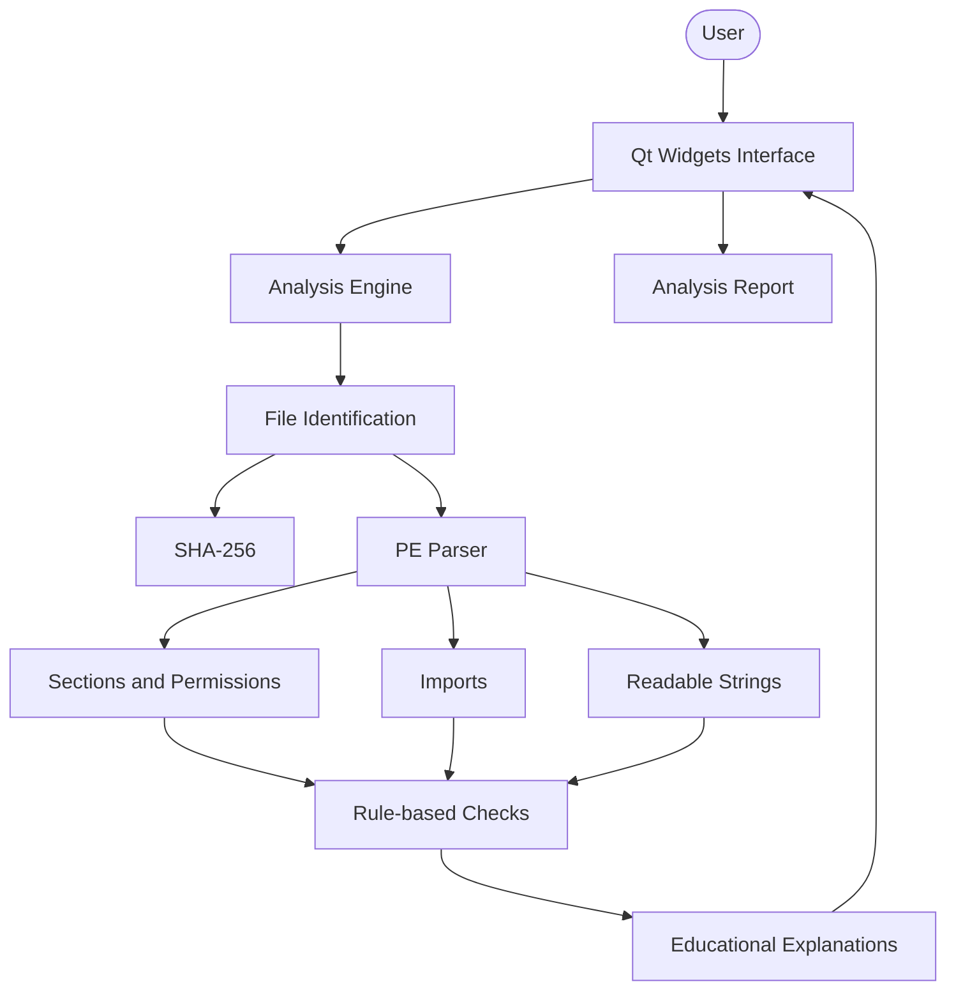

# BinaryLab

**Educational static analysis of Windows executables, built with C++ and Qt.**

**[Documentation](#documentation) · [Build locally](docs/development.md)**

BinaryLab is a desktop application for inspecting Windows executable files (`.exe` and `.dll`) and understanding their internal structure and potential security indicators. It analyzes files without executing them, presenting technical findings alongside explanations of what they mean, why they may matter, and what to investigate next.

The goal is to make executable analysis approachable while building a practical understanding of binary formats, static analysis, and cybersecurity concepts.

## Features

**Planned features**

- **File inspection.** Open executable files and inspect their contents without running them.
- **File identification.** Identify file formats and calculate SHA-256 hashes to establish a reproducible file identifier.
- **PE analysis.** Parse the Portable Executable (PE) format, including headers, sections, and metadata.
- **Section analysis.** Inspect section sizes, memory permissions, and entropy, highlighting configurations that may deserve further investigation.
- **Import analysis.** Explore imported libraries and functions to understand which operating system capabilities a program may use.
- **String extraction.** Extract readable ASCII and UTF-16 strings that can provide useful context about a file.
- **Security indicators.** Apply transparent, rule-based checks to identify potentially unusual executable characteristics.
- **Educational explanations.** Explain findings in plain language, introduce relevant concepts, and suggest useful follow-up checks.
- **Analysis reports.** Present results in a structured format and export reports for later review.

## How it works

The analysis workflow separates file parsing, security checks, and explanations from the graphical interface.



1. **Inspect.** Open a file and collect basic information, including its size, format, and SHA-256 hash.
2. **Parse.** Read the PE headers and sections to understand how the executable is structured.
3. **Extract.** Inspect metadata, section permissions, imported functions, and readable strings.
4. **Analyze.** Apply explicit rules to flag characteristics that may warrant closer inspection.
5. **Explain.** Present the evidence, explain the relevant concepts, and suggest what to examine next.

The full walkthrough, including the structures read at each step, is in [the PE analysis flow](docs/pe-format-analysis.md).

## Technical highlights

The following are the main engineering goals as development progresses:

- **Safe-by-design inspection.** Analyzed files are treated as data and are never intentionally executed by the application.
- **Structured binary parsing.** Read executable fields according to the PE format rather than relying on fixed offsets or assumptions about file contents.
- **Defensive input handling.** Validate offsets, sizes, and boundaries before reading data to handle malformed or truncated files.
- **Transparent analysis rules.** Make it clear which file characteristics triggered a finding and which evidence supports it.
- **Contextual explanations.** Connect technical findings to accessible explanations of executable formats and security concepts.
- **Separation of concerns.** Keep the analysis engine independent of the graphical interface to improve maintainability and testability.
- **Incremental development.** Introduce more advanced analysis only after the underlying file parsing and validation are reliable.

A flagged characteristic is not proof of malicious behavior, and the absence of findings does not establish that a file is safe. BinaryLab aims to explain evidence and potential risks rather than make unsupported malware verdicts.

## Tech stack

| Layer | Technology |
|---|---|
| Language | C++17 |
| Desktop interface | Qt 6 Widgets |
| Build system | CMake |
| Build tool | Ninja |
| Compiler | MinGW-w64 GCC |
| Executable format | Windows Portable Executable (PE) |
| Testing | Automated tests for parsing and analysis logic |
| Version control | Git |

Rationale for each choice: [docs/tech-stack.md](docs/tech-stack.md).

## Testing and code quality

Automated testing is a planned part of the project, particularly because incorrect parsing of binary data can lead to crashes, invalid results, or out-of-bounds memory access.

The intended testing strategy includes:

- **Parser tests:** Verify that PE headers, sections, and metadata are interpreted correctly.
- **Malformed input tests:** Cover truncated files, invalid offsets, inconsistent sizes, and unsupported formats.
- **Analysis rule tests:** Verify that each rule identifies its intended condition without treating every unusual characteristic as malicious.
- **Regression tests:** Preserve previously validated behavior as new analysis capabilities are added.

Build automation and continuous integration may be added as the project grows. No test coverage or code-quality metrics are reported here until they have been measured.

See [docs/development.md](docs/development.md#tests) for how to run the tests locally.

## Quick start

You need Git, CMake, Ninja, a compatible MinGW-w64 compiler, and Qt 6 with the corresponding MinGW kit.

```powershell
git clone <repository-url>
cd binary-lab

cmake -S . -B build -G Ninja `
  -DCMAKE_PREFIX_PATH="C:/Qt/6.12.0/mingw_64"

cmake --build build
```

After a successful build, the executable will normally be located at `build/binary-lab.exe`.

Replace `<repository-url>` with the URL of your GitHub repository and adjust the Qt path to match your installation. Compiler paths, Qt Creator, VS Code, missing Qt DLLs and the day-to-day workflow are covered in the [development guide](docs/development.md).

## Documentation

| Document | What's in it |
|---|---|
| [Tech stack](docs/tech-stack.md) | Technologies and why they were chosen |
| [Functional requirements](docs/functional-requirements.md) | What the MVP does, requirement by requirement |
| [PE analysis flow](docs/pe-format-analysis.md) | End-to-end walkthrough of how a file is parsed, checked and explained, plus the rule catalog |
| [Development guide](docs/development.md) | Environment setup, build instructions, tests and development workflow |

## Scope and limitations

BinaryLab is an educational static analysis tool, not a complete malware detection solution.

- It does not execute the files being inspected.
- Static analysis cannot reveal every behavior that may occur at runtime.
- A suspicious indicator may have a legitimate explanation.
- A file with no reported indicators is not necessarily safe.
- Findings should be interpreted in context and validated before drawing conclusions.

The project prioritizes understandable explanations, reliable parsing, and transparent rules over unsupported claims about whether a file is malicious.

## Development status

BinaryLab is under development. Features described as planned may not yet be available in the application.