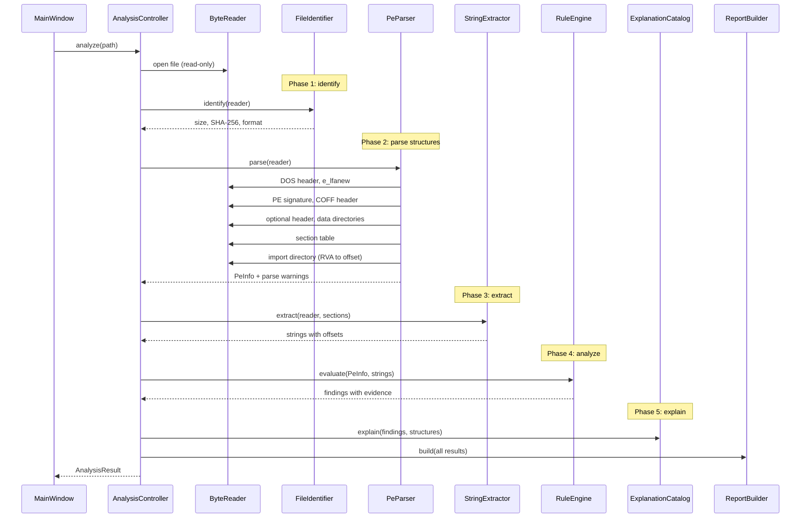

# PE Analysis Flow

This document walks through what happens, end to end, when a user opens an executable in
BinaryLab: from the raw bytes on disk down to how each header, section and import is read,
how findings are produced, and how they become explanations in the interface.

Module names below are the planned ones and may change as the code is written.

> **Status of this document.** It is a design reference, not a verified result. Structure layouts and flag values should be checked against the official specification (see [Sources](#sources)), and the rules and their thresholds are unverified hypotheses until the *Source / how validated* column of the [rule catalog](#rule-catalog) says otherwise.

## At a glance

## Where the code lives

| Module | Responsibility |
|---|---|
| `MainWindow` and views | Qt Widgets interface: opens files, runs the analysis off the UI thread, renders results. Contains no parsing logic |
| `AnalysisController` | Runs the phases in order, collects results and warnings, returns one `AnalysisResult` |
| `ByteReader` | The only code that touches file bytes. Every read is bounds-checked and returns an error instead of reading out of range |
| `FileIdentifier` | Size, SHA-256 and format detection. Knows nothing about PE internals beyond the signatures |
| `PeParser` | Reads DOS, COFF and optional headers, data directories, sections and imports into plain structs |
| `StringExtractor` | ASCII and UTF-16LE string extraction with offsets |
| `RuleEngine` | Runs each rule over the parsed data and returns findings with evidence. Rules are independent of each other |
| `ExplanationCatalog` | Maps structures and rule ids to explanations, legitimate causes and follow-up checks |
| `ReportBuilder` | Builds the report model and serializes it to JSON and Markdown |

Everything except the interface lives in the engine library, which has no Qt dependency.

## Step by step

### 1. Open and identify

`AnalysisController::analyze()` opens the file read-only and hands a `ByteReader` to the
rest of the engine. Nothing in the program ever loads the file as a library or runs it.

`FileIdentifier` then:
- records the file name and size,
- streams the file through SHA-256 in fixed-size chunks (the whole file is not needed in
  memory for hashing),
- checks the first two bytes for `MZ` (`0x5A4D`); a file without them is reported as an
  unsupported format and the analysis stops there, **whatever its extension says**.

A matching `MZ` signature only means "might be a DOS or Windows executable". The PE parser
decides whether it actually is one.

### 2. The DOS header and the PE header offset

Every PE file starts with a small legacy DOS header. Only two fields matter here:

| Field | Offset | Why it matters |
|---|---|---|
| `e_magic` | `0x00` | Must be `MZ` |
| `e_lfanew` | `0x3C` | File offset of the PE signature |

The parser does not assume where the PE headers are. It reads `e_lfanew`, checks that the
offset plus the size of the headers fits inside the file, and jumps there. In real files
this value is commonly `0x80` or `0xF8`, but nothing guarantees it.

### 3. PE signature and COFF file header

At `e_lfanew` the parser expects the four bytes `PE\0\0` (`0x00004550`), followed by the
20-byte COFF file header:

| Field | What it tells us |
|---|---|
| `Machine` | Target architecture (for example x86 `0x14C`, x64 `0x8664`, ARM64 `0xAA64`) |
| `NumberOfSections` | How many section table entries to read |
| `TimeDateStamp` | Build time recorded by the linker (can be arbitrary or zeroed, see [R08](#rule-catalog)) |
| `SizeOfOptionalHeader` | Where the section table starts |
| `Characteristics` | Flags such as "is a DLL" (`0x2000`) and "is executable" (`0x0002`) |

`SizeOfOptionalHeader` is used to locate the section table. The parser does not hard-code
the size of the optional header, because it differs between PE32 and PE32+.

### 4. Optional header and data directories

Despite its name, the optional header is required for executables and DLLs. Its first field,
`Magic`, selects the layout:

- `0x10B` → **PE32** (32-bit)
- `0x20B` → **PE32+** (64-bit)

Fields that change between the two (such as `ImageBase`, which is 4 bytes in PE32 and 8 in
PE32+) are read according to the magic value. The fields BinaryLab surfaces:

| Field | Why it matters |
|---|---|
| `AddressOfEntryPoint` | RVA where execution starts. Checked against the section table by [R02](#rule-catalog) |
| `ImageBase` | Preferred load address |
| `SectionAlignment` / `FileAlignment` | How sections are laid out in memory vs. on disk |
| `SizeOfImage` | Total size once mapped in memory |
| `Subsystem` | Console, GUI, driver and so on |
| `DllCharacteristics` | Mitigation flags: `DYNAMIC_BASE` (ASLR, `0x0040`), `HIGH_ENTROPY_VA` (`0x0020`), `NX_COMPAT` (DEP, `0x0100`) |
| `NumberOfRvaAndSizes` | How many data directory entries follow (validated, capped at 16) |

The data directory table lists where the import table, export table, resources, relocations,
TLS and others live. Each entry is an RVA and a size; an entry of `0, 0` means "absent".

### 5. Section table

Each section header is 40 bytes. The table is read starting right after the optional header:

| Field | Meaning |
|---|---|
| `Name` | 8 bytes, null-padded, not guaranteed to be printable |
| `VirtualSize` / `VirtualAddress` | Size and RVA once mapped in memory |
| `SizeOfRawData` / `PointerToRawData` | Size and file offset on disk |
| `Characteristics` | Content type and memory permissions |

The permission flags that matter most:

| Flag | Value | Meaning |
|---|---|---|
| `IMAGE_SCN_CNT_CODE` | `0x00000020` | Contains code |
| `IMAGE_SCN_MEM_EXECUTE` | `0x20000000` | Can be executed |
| `IMAGE_SCN_MEM_READ` | `0x40000000` | Can be read |
| `IMAGE_SCN_MEM_WRITE` | `0x80000000` | Can be written |

Per section, the engine also computes the **Shannon entropy** of its raw bytes
(0 to 8 bits per byte). Plain code and data usually sit well below the maximum; compressed
or encrypted content sits close to it.

After the last section, any bytes left in the file are recorded as the **overlay**
(offset and size). Installers and signed files legitimately have one.

### 6. From RVA to file offset

Most pointers inside a PE file are **RVAs**: addresses relative to where the image will be
loaded, not offsets in the file. To read the data an RVA points to, the parser:

1. finds the section where `VirtualAddress ≤ RVA < VirtualAddress + max(VirtualSize, SizeOfRawData)`,
2. computes `offset = RVA − VirtualAddress + PointerToRawData`,
3. checks that the resulting range lies inside both the section's raw data and the file.

An RVA that matches no section, or maps beyond the end of the file, is recorded as a parse
warning and that structure is skipped instead of guessed.

### 7. Imports

The import directory (data directory index 1) is an array of 20-byte
`IMAGE_IMPORT_DESCRIPTOR` entries, terminated by an all-zero entry. For each one, the parser:

1. converts the `Name` RVA and reads the library name (a bounded, null-terminated string),
2. follows the import lookup table (`OriginalFirstThunk`, falling back to `FirstThunk` when
   it is zero),
3. reads each thunk, which is 4 bytes in PE32 and 8 in PE32+. If the highest bit is set the
   function is imported **by ordinal**; otherwise the thunk is an RVA to a 2-byte hint
   followed by the function name.

Loops over descriptors and thunks have explicit upper limits so a corrupted table cannot
spin forever. Imported function names are matched against a small table of notable APIs,
grouped by capability (process and memory, networking, registry, cryptography, file system),
so the interface can say *what the program may be able to ask the operating system to do*.

Imports describe what a program links against at load time. Code can also resolve functions
at runtime (for example with `LoadLibrary` and `GetProcAddress`), so the import table is
evidence, not a complete list.

### 8. Strings

`StringExtractor` scans the file for runs of printable characters in two encodings:

- **ASCII**: sequences of printable single bytes,
- **UTF-16LE**: sequences of printable characters stored as two bytes each (common for
  Windows API paths and messages).

The default minimum length is 4 characters and is adjustable. Each result keeps its file
offset and, when it falls inside a section, the section it belongs to. Total output is
capped so a large file cannot exhaust memory.

### 9. Rules and findings

`RuleEngine` evaluates every rule independently over the parsed structures and the
extracted strings. A rule never modifies the data it reads. Each finding contains:

- the rule id and a severity (informational, low or medium),
- a short title,
- the **evidence**: exact field names and values, section names, offsets, imported
  function names,
- a link to the explanation entry for that rule.

#### Rule catalog

The initial catalog. **Nothing in this table has been validated yet.** Thresholds are starting points to be tuned against real benign files, and each row's last column is filled in only once the rule has been checked against a source or against your own measurements. Until then, treat the rule as a hypothesis.

| Id | Check | Evidence used | Common legitimate causes | Source / how validated |
|---|---|---|---|---|
| R01 | A section is both writable and executable | Section name, `Characteristics` | Some packers and JIT-style code, older toolchains | Unverified. To check: Microsoft PE Format (section flags); *Practical Malware Analysis*, packing chapter |
| R02 | Entry point is outside every executable section, or inside the last section | `AddressOfEntryPoint`, section table | Packers and protectors, some installers | Unverified. To check: *Practical Malware Analysis*, packing chapter; compare with PE-bear and Detect It Easy |
| R03 | A section has very high entropy (about 7.0 bits per byte or more) and a non-trivial raw size | Per-section entropy, raw size | Compressed resources, embedded archives, protected software | Unverified (threshold is an approximation). To check: entropy and packing literature; measure benign and packed samples |
| R04 | A section's virtual size is much larger than its raw size, or its raw size is zero while the virtual size is not | `VirtualSize`, `SizeOfRawData` | Uninitialized data (`.bss`-like sections) | Unverified. To check: Microsoft PE Format (section table); compare with PE-bear |
| R05 | Section names outside a list of common compiler and linker names | Section names | Custom toolchains, game engines, some runtimes | Unverified. To check: list of section names produced by MinGW and MSVC; compare with PE-bear |
| R06 | Very few imported functions in total | Import counts | Small tools, static linking, runtime-resolved imports | Unverified. To check: *Practical Malware Analysis*, static analysis chapters; measure benign files |
| R07 | Imports grouped under capabilities that deserve attention (for example process injection primitives, remote thread creation, raw networking, registry persistence) | Imported library and function names | Debuggers, security tools, installers, system utilities | Unverified. To check: MITRE ATT&CK (for example T1055); Microsoft documentation of each API |
| R08 | Timestamp is zero, or later than the analysis date | `TimeDateStamp` | Reproducible builds intentionally zero or fix the value | Unverified. To check: Microsoft PE Format (`TimeDateStamp`); documentation on reproducible builds |
| R09 | `DYNAMIC_BASE` (ASLR) or `NX_COMPAT` (DEP) is not set | `DllCharacteristics` | Legacy software, intentionally minimal builds | Unverified. To check: Microsoft PE Format (`DllCharacteristics`); Microsoft documentation on ASLR and DEP |
| R10 | Structural inconsistencies: overlapping sections, sections beyond the end of file, header sizes that do not add up | Offsets and sizes involved | Slightly non-conforming linkers, damaged downloads | Unverified. To check: Microsoft PE Format; build malformed test files and compare with `pefile` |
| R11 | Data present after the last section (overlay) | Overlay offset and size | Digital signatures, installers, self-extracting archives | Unverified. To check: Microsoft PE Format (attribute certificates); compare with PE-bear |

No rule says "malicious". Rules R07 in particular report a *capability*, not an *intent*.

### 10. Explanations and report

`ExplanationCatalog` attaches to each finding:

- **What it is**: the structure or flag in plain language,
- **Why it may matter**: what the characteristic is sometimes used for,
- **Legitimate causes**: why a normal program may look exactly like this,
- **What to check next**: concrete follow-up steps, for example inspect the section's bytes
  in a hex viewer, compare with another build, or check the signature.

Structures with no finding (such as the DOS header) also have an explanation entry, so the
interface can teach the format even when nothing was flagged.

`ReportBuilder` then assembles file information, parsed structures, warnings, findings with
their evidence and the explanations shown, and serializes the result to JSON and Markdown.
Reports always include the SHA-256 hash, the BinaryLab version and the analysis date.

## Defensive parsing

The input is untrusted, and PE files in the wild are frequently damaged or deliberately
malformed. These rules apply to all parsing code:

| Situation | Behavior |
|---|---|
| Not a PE file (no `MZ`, or no `PE\0\0` at `e_lfanew`) | Report an unsupported format, stop |
| `e_lfanew` or any header would extend past the end of the file | Report a truncated file, keep what was already read |
| `NumberOfSections` or `NumberOfRvaAndSizes` is implausibly large | Clamp to a safe limit and record a warning |
| Section raw range lies partly or fully outside the file | Skip entropy for that section and record a warning |
| RVA does not belong to any section | Skip that structure and record a warning |
| Import descriptors, thunks or names never terminate | Stop at a fixed upper bound and record a warning |
| Arithmetic on offsets and sizes could overflow | Checked before use, never wrapped |

All of these go through `ByteReader`. No other code reads file bytes, so there is exactly
one place where bounds checking has to be correct, and one place to fuzz and test.

Failures are values, not exceptions or crashes: the result carries partial data and a list
of warnings so the interface can still show everything that could be read (FR-E31, FR-E32).

## Known limitations

- **Packed and protected files.** Packers compress or encrypt the original code, so the
  visible imports, strings and sections describe the *packer*, not the program inside.
  High entropy and a tiny import table are hints that this may be the case, not proof.
- **Runtime behavior is invisible.** Dynamically resolved functions, downloaded payloads,
  injected code and anything created after launch cannot be seen.
- **Rules are heuristics.** Each rule has legitimate triggers (see the table above) and the
  thresholds are approximations. Expect false positives and false negatives.
- **Managed code.** .NET assemblies parse as ordinary PE files, but their real content lives
  in CLR metadata that the MVP does not read.
- **Scope.** Only PE32 and PE32+ are handled.

## Sources and References

The following sources will support the implementation and validation of BinaryLab. They cover the PE format specification, binary analysis techniques, security-related indicators and reference tools for comparing parser results.

### Specification

- [**Microsoft Learn — PE Format**](https://learn.microsoft.com/en-us/windows/win32/debug/pe-format): authoritative reference for PE structures, field offsets, data directories, section characteristics and related flags.

### PE Format Visual References

- [**Ange Albertini (corkami) — PE Format Posters**](https://github.com/corkami/pics): visual references for PE structures and their relationships.
- [**Matt Pietrek — An In-Depth Look into the Win32 Portable Executable File Format, Part 1**](https://learn.microsoft.com/en-us/archive/msdn-magazine/2002/february/inside-windows-win32-portable-executable-file-format-in-detail): explanations of PE internals, headers, sections and related implementation details.
- [**Matt Pietrek — An In-Depth Look into the Win32 Portable Executable File Format, Part 2**](https://learn.microsoft.com/en-us/archive/msdn-magazine/2002/march/inside-windows-an-in-depth-look-into-the-win32-portable-executable-file-format-part-2): further details on PE structures and implementation.

### Books and Technical Literature

- [**Practical Malware Analysis — Michael Sikorski and Andrew Honig**](https://nostarch.com/malware): reference for static analysis techniques, PE structures and executable packing.
- [**Practical Binary Analysis — Dennis Andriesse**](https://nostarch.com/binaryanalysis): reference for implementing binary analysis tools and working with executable formats.

### Security Indicators and Mitigations

- [**MITRE ATT&CK — T1055: Process Injection**](https://attack.mitre.org/techniques/T1055/): reference for understanding process injection techniques and relating imported APIs to documented adversary behaviors.
- [**Microsoft Learn — Data Execution Prevention (DEP)**](https://learn.microsoft.com/en-us/windows/win32/memory/data-execution-prevention): documentation on DEP and its role in preventing code execution from protected memory regions.
- [**Microsoft Learn — Memory Protection and ASLR**](https://learn.microsoft.com/en-us/windows/win32/memory/memory-protection): reference for understanding address-space layout randomization and its security implications.
- [**Microsoft Learn — PE Format: Executable Characteristics**](https://learn.microsoft.com/en-us/windows/win32/debug/pe-format): reference for interpreting the `DllCharacteristics` flags associated with ASLR, DEP and related executable properties.
- [**Practical Malware Analysis — Entropy and Packed Executables**](https://nostarch.com/malware): technical reference for evaluating entropy-based indicators, potential packing and their limitations. Thresholds must be validated against representative samples rather than treated as universal rules.

### Reference Tools for Validation

- [**PE-bear**](https://github.com/hasherezade/pe-bear): inspect headers, sections and imports to compare against BinaryLab's parser output.
- [**CFF Explorer**](https://ntcore.com/explorer-suite/): inspect PE structures, headers, sections and imports using a graphical interface.
- [**Detect It Easy (DiE)**](https://github.com/horsicq/Detect-It-Easy): examine executable formats, section entropy and potential packers.
- [**GNU `objdump` — `objdump -x`**](https://sourceware.org/binutils/docs/binutils/objdump.html): inspect executable metadata and available PE structures using MinGW's binary utilities.
- [**Microsoft `DUMPBIN` — `/headers`**](https://learn.microsoft.com/en-us/cpp/build/reference/dumpbin-options): inspect executable headers using the Microsoft C++ toolchain.
- [**Python `pefile`**](https://github.com/erocarrera/pefile): independent reference for comparing parsed fields and identifying discrepancies. BinaryLab will not depend on this library.
- [**HxD**](https://mh-nexus.de/en/hxd/): inspect raw bytes and verify file offsets, signatures and field values using a hexadecimal editor.

## Validation Workflow

The following order defines the planned implementation and validation sequence:

1. **Binary fundamentals:** bytes, hexadecimal representation, little-endian encoding and file offsets.
2. **DOS header:** validate the `MZ` signature and the `e_lfanew` field.
3. **PE and COFF headers:** validate the PE signature, machine type, section count and header sizes.
4. **Optional header:** validate PE32 and PE32+ layouts, key fields and data directories.
5. **Section table:** validate section boundaries, sizes, characteristics and memory permissions.
6. **RVA mapping:** verify conversions from relative virtual addresses to file offsets, including invalid ranges.
7. **Imports:** validate library names, imported functions, ordinal imports and table termination.
8. **Strings and entropy:** compare extracted strings and entropy calculations against independent results.
9. **Analysis rules:** evaluate indicators against known benign files and, where appropriate, packed or otherwise unusual samples.

For each implementation stage, the relevant specification and reference tools will be used to check expected behavior. Automated tests will cover valid inputs, malformed or truncated files, boundary conditions and discrepancies found during validation.

Rule thresholds and heuristic assumptions will remain marked as unverified until supported by documentation, reproducible measurements or documented test results.

## Related documents

- [Functional requirements](functional-requirements.md) — FR-E01 to FR-E35
- [Tech stack](tech-stack.md) — why the parser and the engine are written this way
- [Development guide](development.md) — building the project and running the tests